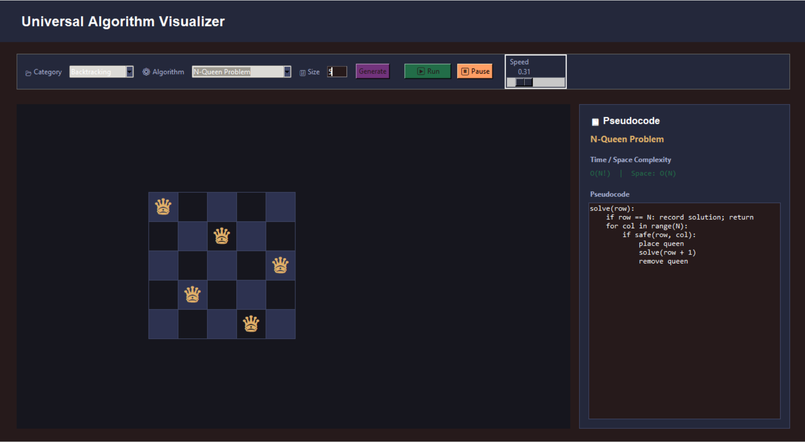
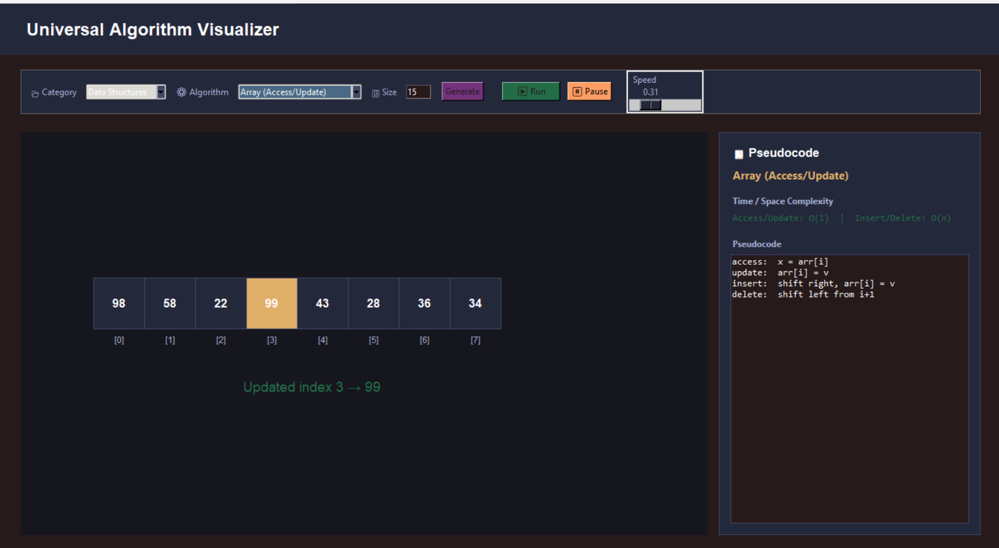
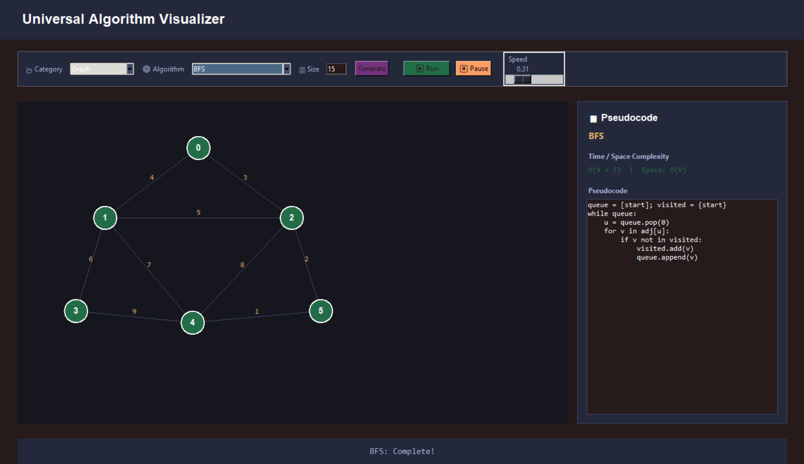
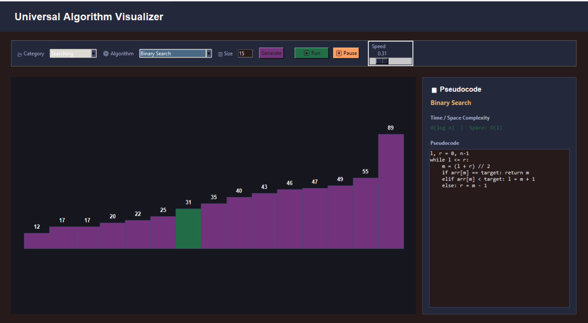
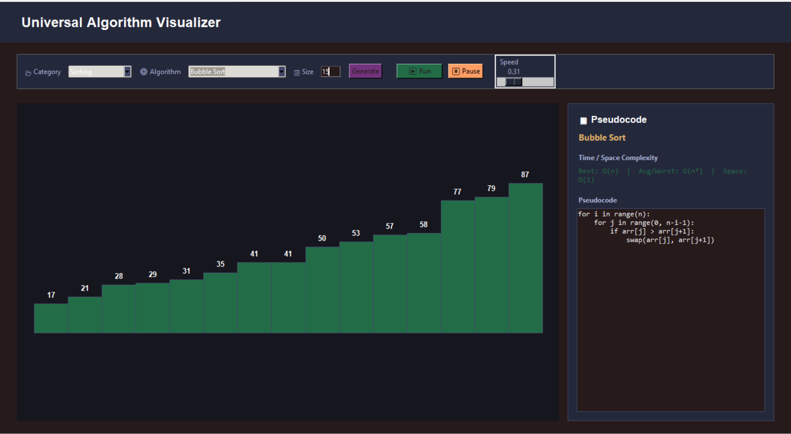
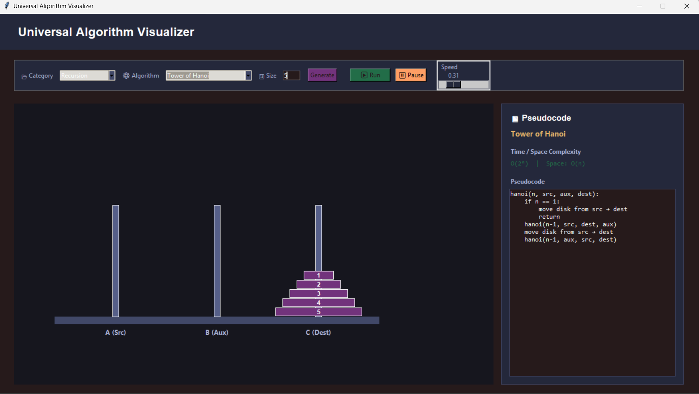
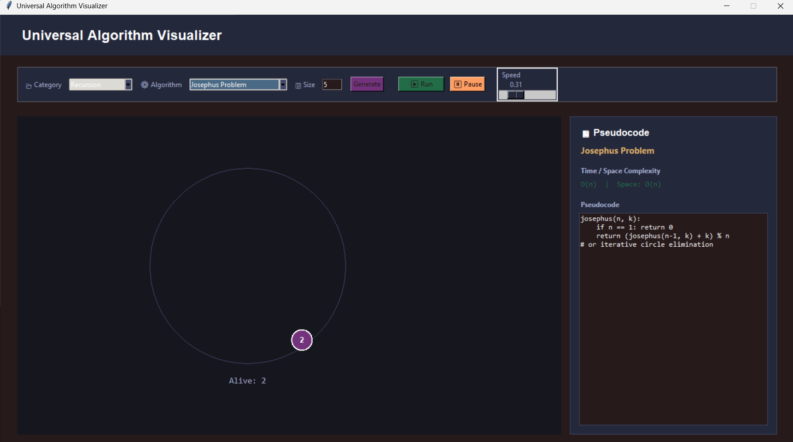
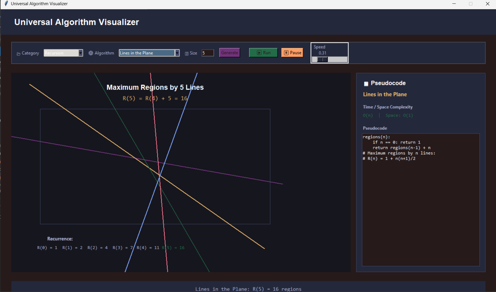
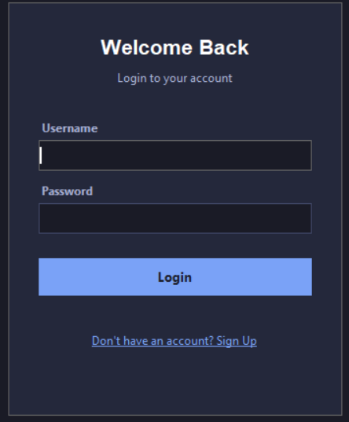

# 🚀 Universal Algorithm Visualizer

An interactive Python desktop application for learning **Data Structures, Algorithms, Recursion, and Dynamic Programming** through step-by-step visualizations and an intuitive graphical user interface.

## 📌 Project Overview

**Universal Algorithm Visualizer** is a Python-based desktop application developed using **Tkinter** to help students understand complex algorithms and data structures through interactive visual demonstrations.

The application brings multiple algorithmic techniques together in one platform, allowing learners to explore how algorithms work, understand their execution steps, and strengthen their problem-solving skills.

The project has evolved through multiple versions, with the latest update expanding its algorithm collection to include sorting, searching, graph algorithms, backtracking, recursion, and dynamic programming.

## ✨ Key Features

- Interactive algorithm visualization
- Step-by-step algorithm execution
- Graphical user interface built with Tkinter
- Multiple algorithm categories in one application
- Sorting and searching algorithm demonstrations
- Data structure visualization
- Graph traversal and graph optimization algorithms
- Classic recursion problems
- Dynamic programming problem-solving techniques
- Backtracking algorithm demonstrations
- Educational interface for learning Data Structures and Algorithms

## 🧩 Algorithm Categories

### 1. Sorting Algorithms

- Bubble Sort
- Selection Sort
- Insertion Sort
- Merge Sort
- Quick Sort
- Heap Sort
- Bucket Sort

### 2. Searching Algorithms

- Linear Search
- Binary Search
- Jump Search
- Interpolation Search
- Exponential Search

### 3. Data Structures

- Array
- Linked List
- Stack
- Queue
- Binary Tree Representation

### 4. Graph Algorithms

**Graph Traversal**
- Breadth-First Search (BFS)
- Depth-First Search (DFS)

**Shortest Path Algorithms**
- Dijkstra's Algorithm
- Bellman-Ford Algorithm
- Floyd–Warshall Algorithm

**Minimum Spanning Tree Algorithms**
- Prim's Algorithm
- Kruskal's Algorithm

### 5. Backtracking Algorithms

- N-Queens Problem
- Sudoku Solver
- Subset Generation
- Graph Coloring Problem
- Travelling Salesman Problem (TSP)

### 6. Recursion Algorithms

Explore classic problems solved using recursive function calls.

- Tower of Hanoi (TOH)
- Josephus Problem
- Line in the Plane
- Fibonacci — Recursive Approach
- Fibonacci — Iterative Approach
- Fibonacci — Matrix Exponentiation
- Factorial — Recursive Approach
- Permutations — Recursive Approach

These problems help learners explore recursive thinking, base cases, function calls, and alternative approaches to solving computational problems.

### 7. Dynamic Programming Algorithms

Learn how overlapping subproblems and reusable solutions can improve algorithm efficiency.

- Fibonacci Sequence
- 0/1 Knapsack Problem
- Longest Common Subsequence (LCS)
- Coin Change Problem
- Edit Distance
- Longest Increasing Subsequence (LIS)
- Climbing Stairs Problem

These problems introduce important dynamic programming concepts, including subproblem decomposition, memoization, tabulation, and the reuse of previously computed results where applicable.

## 🕰️ Project Evolution

### Previous Version

The initial version focused on fundamental algorithms and data structures.

- **Sorting:** Bubble Sort, Selection Sort, Insertion Sort, Merge Sort, Quick Sort
- **Searching:** Linear Search, Binary Search
- **Data Structures:** Stack, Queue

### Latest Updated Version

The latest version expands the original collection with additional algorithm categories and learning opportunities.

- Additional sorting and searching algorithms
- Array, Linked List, and Binary Tree Representation
- Graph traversal, shortest path, and minimum spanning tree algorithms
- Backtracking problems
- Recursion algorithms
- Dynamic programming problems
- Improvements to the graphical interface and learning experience

## 🛠️ Technologies Used

| Technology | Purpose |
|---|---|
| Python | Core programming language |
| Tkinter | Desktop graphical user interface |
| Data Structures | Organizing and representing data |
| Algorithms | Implementing computational problem-solving techniques |

## 📂 Repository Structure

```text
Universal-Algorithm-Visualizer/
│
├── README.md
├── Universal Algorithm Visualizer Update.py
└── AI Responsive Chatbot.zip
```

*Note: The repository structure above reflects the files listed in the current project description. Update it if your repository contains additional files or folders.*

## ⚙️ Installation and Setup

### Prerequisites

- Python 3.x
- Git (optional, for cloning the repository)

### Step 1: Clone the Repository

```bash
git clone <YOUR_GITHUB_REPOSITORY_URL>
```

### Step 2: Navigate to the Project Directory

```bash
cd Universal-Algorithm-Visualizer
```

### Step 3: Run the Application

Run the main Python file:

```bash
python "Universal Algorithm Visualizer Update.py"
```

If your system uses the `python3` command, run:

```bash
python3 "Universal Algorithm Visualizer Update.py"
```

Tkinter is included with many standard Python installations. If Tkinter is unavailable, install or configure the appropriate package for your operating system.

### Screenshots

### Backtracking Algorithms



### Create Account Interface


### Data Structures



### Graph Algorithms



### Searching Algorithms



### Sorting Algorithms



### Tower of Hanoi


### Joshepus Problem


### Line in The Plane


### Welcome Back (Login Interface)




## 🎯 Project Objectives

- Make algorithm learning more visual and accessible.
- Help students understand algorithm execution step by step.
- Demonstrate different approaches to solving computational problems.
- Explore recursive problem-solving and dynamic programming.
- Provide a centralized desktop application for practicing core Data Structures and Algorithms.
- Support programming practice and algorithmic thinking.

## 📚 Learning Outcomes

Working with this project provides opportunities to explore:

- Algorithm design and implementation
- Data structure fundamentals
- Recursion and recursive function calls
- Dynamic programming and subproblem optimization
- Graph traversal and shortest path techniques
- Backtracking
- Python GUI development with Tkinter
- Comparing alternative algorithmic approaches

## 🔮 Future Improvements

Potential future enhancements include:

- Algorithm time and space complexity comparison
- Adjustable visualization speed
- Pause, resume, and step controls
- Input customization for supported algorithms
- Execution statistics and performance comparisons
- More advanced graph and optimization algorithms
- Improved documentation and interactive learning explanations

## 👨‍💻 Developer

**Solo Developer**

Developed as a university project to provide an interactive learning environment for Data Structures and Algorithms using Python and Tkinter.

## 📄 License

No license is specified in this project description. Add a license, such as the MIT License, only after deciding how you want others to use, modify, and distribute your code.

---

⭐ **If you find this project useful for learning algorithms, consider starring the repository on GitHub.**
