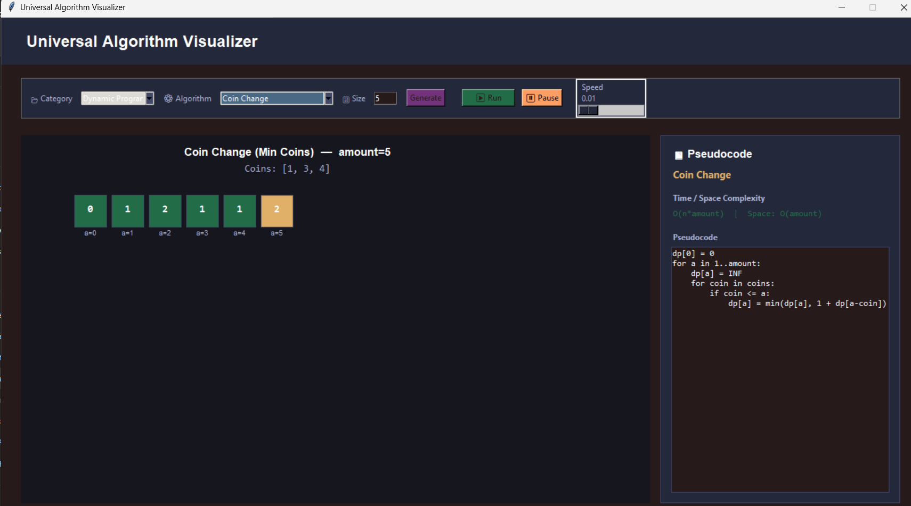

# 🚀 Universal Algorithm Visualizer

**An Interactive Python Desktop Application for Data Structures, Algorithms, Recursion, and Dynamic Programming**

Universal Algorithm Visualizer is a Python-based desktop application built with Tkinter that helps students understand complex algorithms through interactive visualizations, customizable inputs, pseudocode exploration, and step-by-step execution.

The project brings multiple algorithmic techniques into one learning environment, covering sorting, searching, graph algorithms, data structures, recursion, backtracking, and dynamic programming.

With the addition of the **Modify Mode**, the application is designed to let learners experiment with custom input values, adjust array sizes, explore supported pseudocode modifications, and observe how changes affect algorithm execution.

---

## ✨ Key Features

* **Interactive Algorithm Visualization** — Observe algorithm execution through graphical representations.
* **Step-by-Step Simulation** — Follow individual operations and understand how algorithms process data.
* **Dynamic Input Customization** — Choose the number of input elements and enter custom values.
* **Editable Pseudocode** — Explore supported modifications while preserving the original pseudocode.
* **Modify Mode** — Configure input values and supported algorithm logic before starting a new simulation.
* **Execution Step Counter** — Track the current step, total generated steps, and execution progress.
* **Algorithm-Specific Visualization** — Visualize sorting, searching, graph traversal, recursion, and other supported operations.
* **Data Structure Exploration** — Understand arrays, linked lists, stacks, queues, and binary tree representations.
* **Multiple Algorithm Categories** — Explore classical and advanced problem-solving techniques in one application.
* **Tkinter-Based Desktop GUI** — Use a graphical interface built with Python.

## 🆕 Modify Mode — Customize, Experiment, and Visualize

Modify Mode extends the traditional algorithm visualization workflow by allowing users to experiment with algorithm inputs and supported pseudocode changes.

### 1. Dynamic Array Size and Custom Inputs

* Specify the desired number of array elements.
* Generate input fields dynamically according to the selected size.
* Enter custom positive integers, negative integers, zeros, and duplicate values.
* Increase or decrease the array size while preserving existing values where possible.
* Validate input before starting a simulation.

Example:

```python
Array Size: 7

Input:
[42, 15, 8, 23, 10, 31, -4]
```

The simulation uses the configured input rather than relying exclusively on predefined example values.

### 2. Original and Modified Pseudocode

Modify Mode separates the original algorithm pseudocode from the editable version.

* View the original pseudocode without modifying it.
* Edit a separate copy of the pseudocode.
* Reset the edited version to the original.
* Validate supported pseudocode statements.
* Apply valid changes or cancel unapplied modifications.
* Receive clear validation messages for unsupported or invalid changes.

The simulation should reflect the applied logic for supported modifications instead of merely displaying edited text.

### 3. Fresh Simulation After Modification

After applying valid changes, the application can initialize a new simulation using the selected input and supported modified logic.

* Reset previous simulation states.
* Generate a new execution trace.
* Display the applicable pseudocode.
* Start from the first step.
* Update the visualization as operations execute.

### 4. Step Tracking and Execution Insights

The simulation interface can present execution information such as:

* Current step and total generated steps.
* Current operation being performed.
* Array comparisons and swaps for sorting algorithms.
* Current index and search progress for searching algorithms.
* Relevant state changes for supported data structures and algorithms.

Existing simulation controls should remain available and retain their original behavior.

> **Compatibility principle:** Modify Mode is an extension of the existing application. Original algorithms, pseudocode, visualizations, and existing features should remain intact.

---

## 🧩 Algorithm Categories

### 1. Sorting Algorithms

* Bubble Sort
* Selection Sort
* Insertion Sort
* Merge Sort
* Quick Sort
* Heap Sort
* Bucket Sort

### 2. Searching Algorithms

* Linear Search
* Binary Search
* Jump Search
* Interpolation Search
* Exponential Search

### 3. Data Structures

* Array
* Linked List
* Stack
* Queue
* Binary Tree Representation

### 4. Graph Algorithms

**Graph Traversal**

* Breadth-First Search (BFS)
* Depth-First Search (DFS)

**Shortest Path Algorithms**

* Dijkstra's Algorithm
* Bellman–Ford Algorithm
* Floyd–Warshall Algorithm

**Minimum Spanning Tree**

* Prim's Algorithm
* Kruskal's Algorithm

### 5. Backtracking Algorithms

* N-Queens Problem
* Sudoku Solver
* Subset Generation
* Graph Coloring Problem
* Travelling Salesman Problem (TSP)

### 6. Recursion Algorithms

* Tower of Hanoi (TOH)
* Josephus Problem
* Line in the Plane
* Fibonacci — Recursive Approach
* Fibonacci — Iterative Approach
* Fibonacci — Matrix Exponentiation
* Factorial — Recursive Approach
* Permutations — Recursive Approach

### 7. Dynamic Programming Algorithms

* Fibonacci Sequence
* 0/1 Knapsack Problem
* Longest Common Subsequence (LCS)
* Coin Change Problem
* Edit Distance
* Longest Increasing Subsequence (LIS)
* Climbing Stairs Problem

These algorithms demonstrate concepts such as overlapping subproblems, memoization, tabulation, and optimal substructure.

---

## 🛠️ Technologies Used

| Technology      | Purpose                                               |
| --------------- | ----------------------------------------------------- |
| Python 3        | Core application logic and algorithm implementation   |
| Tkinter         | Desktop graphical user interface                      |
| Data Structures | Organizing and representing data                      |
| Algorithms      | Implementing computational problem-solving techniques |
| Git and GitHub  | Version control and project hosting                   |

---

## 📂 Repository Structure

```text
Universal-Algorithm-Visualizer/
│
├── README.md
├── Universal Algorithm Visualizer Update.py
├── AI Responsive Chatbot.zip
│
└── screenshots/
    ├── Backtracking.png
    ├── CreateAccount.png
    ├── DataStructure.png
    ├── Graph.png
    ├── Searching.png
    ├── Sorting.png
    ├── TowerofHanoi.png
    ├── JoshepusProblem.png
    ├── WelcomeBack.png
    ├── LineinTheplane.png
    └── CoinChange.png
```

*Note: This structure reflects the files described in this README. Update it if your actual repository contains additional files, modules, or directories.*

---

## ⚙️ Installation and Setup

### Prerequisites

* Python 3.x
* Git (optional)
* A Python installation with Tkinter support

### 1. Clone the Repository

```bash
git clone <YOUR_GITHUB_REPOSITORY_URL>
```

### 2. Navigate to the Project Directory

```bash
cd Universal-Algorithm-Visualizer
```

### 3. Run the Application

```bash
python "Universal Algorithm Visualizer Update.py"
```

If your system uses `python3`:

```bash
python3 "Universal Algorithm Visualizer Update.py"
```

On Debian-based Linux systems, if Tkinter is unavailable, you may need:

```bash
sudo apt update
sudo apt install python3-tk
```

---

## 🖼️ Application Screenshots

Screenshots below demonstrate the application's existing interfaces and algorithm categories.

### Sorting Algorithms


### Searching Algorithms


### Data Structures


### Graph Algorithms


### Backtracking Algorithms


### Tower of Hanoi


### Josephus Problem


### Coin Change



### Create Account


### Welcome Back


### Line in the Plane


*To showcase Modify Mode, add screenshots of the dynamic input editor, pseudocode editor, and modified simulation when those interfaces are available in the repository.*

---

## 🎯 Project Objectives

* Make algorithm learning more visual, interactive, and accessible.
* Help students understand algorithm execution one step at a time.
* Encourage experimentation with custom inputs.
* Demonstrate how supported pseudocode changes affect algorithm behavior.
* Explain fundamental and advanced data structures and algorithms.
* Provide a centralized desktop learning environment for algorithmic problem-solving.

## 📚 Learning Outcomes

This project provides opportunities to explore:

* Algorithm design and implementation.
* Data structure fundamentals.
* Recursion and recursive function calls.
* Dynamic programming and subproblem optimization.
* Graph traversal and shortest-path algorithms.
* Backtracking and combinatorial problems.
* Python desktop GUI development with Tkinter.
* Pseudocode interpretation and algorithm tracing.
* Step-by-step execution and debugging concepts.
* Input validation and simulation state management.

---

## 🔮 Future Improvements

Potential enhancements include:

* Algorithm time and space complexity analysis.
* Execution-time and memory-usage comparisons.
* Additional editable pseudocode constructs.
* Expanded Modify Mode support across all algorithm categories.
* Interactive algorithm explanations and learning hints.
* Exportable simulation traces.
* More graph and optimization algorithms.
* Improved documentation and automated testing.

---

## 👨‍💻 Developer

**Developed as a university project**

Universal Algorithm Visualizer is designed to support the learning of Data Structures and Algorithms through Python-based interactive visualizations.

---

## 📄 License

No license is currently specified. Add an appropriate open-source license if you intend to allow others to use, modify, and distribute this project.

---

⭐ If you find this project useful for learning algorithms, consider starring the repository on GitHub.
